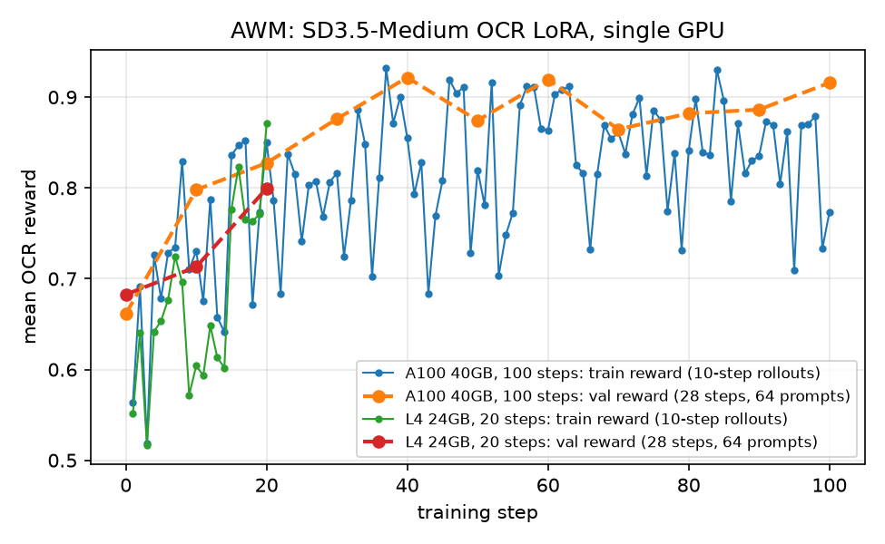

# AWM Trainer

Last updated: 10/18/2026

This example post-trains `stabilityai/stable-diffusion-3.5-medium` with
AWM (Advantage Weighted Matching, [paper](https://arxiv.org/abs/2509.25050))
on the OCR task, using `vllm-omni` rollout and `Qwen/Qwen2.5-VL-3B-Instruct`
as the OCR reward model. It mirrors the
[DGPO example](../dgpo_trainer/README.md) and shares its SD3.5 adapters.

AWM is an online forward-process algorithm: rollouts stay on the deterministic
ODE sampler (noise level 0), the actor re-noises the final clean latents at a few
shared forward timesteps, and the per-sample flow-matching error `-log p` is
weighted by the GRPO group advantage through a PPO-style clipped ratio against
the `old` LoRA adapter. The `old` adapter is also the EMA copy of the policy
(`algorithm.old_policy_decay_schedule=linear_to_0_3`, the paper's
`min(0.001 n, 0.3)` rate) that the `awm_kl_coef` velocity-space KL pulls toward.

Loss knobs under `actor_rollout_ref.actor.diffusion_loss`:

- `awm_clip_range`: PPO clip range on `exp(old_dsm - dsm)`; `0` disables clipping.
- `awm_kl_coef`: coefficient of the velocity MSE toward the EMA (`old`) adapter.
- `ref_kl_coef`: coefficient of the velocity MSE toward the base model (adapters off).
- `adv_clip_max`: advantage clamp.

`algorithm.train_timestep_range` / `train_timestep_count` / `timestep_fraction`
pick the training timesteps exactly as for DGPO.

## Installation

Follow the [installation guide](../../docs/start/install.md), then install the
OCR reward dependency:

```bash
uv pip install -e ".[ocr]"
```

The script defaults to one node with 2 actor/rollout GPUs and 1 reward GPU
(`NUM_GPUS_ACTOR_ROLLOUT`, `NUM_GPUS_REWARD`).

## Prepare the dataset

Get the raw OCR prompts from the original Flow-GRPO repository
(https://github.com/yifan123/flow_grpo/tree/main/dataset/ocr), place them under
`$WORKSPACE/data/ocr` (`WORKSPACE` defaults to `$HOME`), and convert them:

```bash
python3 examples/flowgrpo_trainer/data_process/sd3_ocr.py \
  --input_dir $WORKSPACE/data/ocr \
  --output_dir $WORKSPACE/data/ocr/sd3
```

## Run

```bash
bash examples/awm_trainer/sd35/run_sd35_medium_ocr_lora_v1.sh
```

Unlike DGPO, AWM does not need whole rollout groups inside one micro batch; the
batch sizes in the script are kept equal to the DGPO recipe for a side-by-side.

## Tested configuration

### 100 steps on 1x A100 40GB (Colab Pro)

- 1x NVIDIA A100-SXM4-40GB, 83GB host RAM, driver 580.82, Linux, BF16
- Python 3.12, torch 2.13.0+cu132, vllm 0.30.0, vllm-omni 0.30.1.dev29+g12e928001,
  diffusers 0.40.0, transformers 5.14.1
- Everything on the one GPU: `NUM_GPUS_ACTOR_ROLLOUT=1`, the reward model colocated
  (`reward.reward_model.enable_resource_pool=False`, `reward.models.ocr.offload=True`,
  `reward.models.ocr.rollout.gpu_memory_utilization=0.35`, `max_num_batched_tokens=4096`,
  `max_num_seqs=16`), rollout `engine_kwargs.vllm_omni.max_num_seqs=16`,
  `ray_kwargs.ray_init.num_cpus=32` (Colab exposes 12 vCPUs, fewer than the actors
  request), `RAY_memory_monitor_refresh_ms=0`, attention `native` / `TORCH_SDPA`
- `sd35/run_sd35_medium_ocr_lora_v1.sh` for 100 steps, validating on 64 test prompts
  every 10 steps, took 81 s per training step (rollout 25 s, reward 7 s, actor
  update 43 s). OCR validation reward:

  | step | 0 | 10 | 20 | 30 | 40 | 50 | 60 | 70 | 80 | 90 | 100 |
  |---|---|---|---|---|---|---|---|---|---|---|---|
  | reward | 0.661 | 0.798 | 0.827 | 0.876 | 0.922 | 0.874 | 0.920 | 0.865 | 0.882 | 0.886 | 0.916 |

  The training-batch reward (10-step rollouts) rose from 0.73 (mean of steps 1-20) to
  0.84 (steps 81-100). `actor/ratio_mean` stayed within 0.99-1.01, `actor/clip_frac`
  0.2-0.5, `actor/ema_kl_loss` 5e-5 to 1.5e-3.

### 20 steps on 1x L4 24GB (GCP g2-standard-16)

- 1x NVIDIA L4 24GB, 62GB host RAM, driver 615.71, Linux, BF16; same Python stack
- Reward model colocated and served in fp8
  (`reward.models.ocr.rollout.engine_kwargs.vllm.quantization=fp8`,
  `gpu_memory_utilization=0.4`), actor `fsdp_config.param_offload=True`, rollout
  `engine_kwargs.vllm_omni.max_num_seqs=8`, a 32GB swapfile for host-RAM peaks
- 180 s per training step (rollout 81 s, reward 9 s, actor update 84 s); OCR
  validation reward 0.683 at step 0, 0.713 at step 10 and 0.799 at step 20


